# 认知副驾（Cognitive Copilot）分析设计文档

**对象模型：分析阶段的领域类与分析类 · 设计阶段的类图与交互**

| 项 | 内容 |
|---|---|
| 项目 | 认知副驾 —— 个人知识学习 AI 智能体 |
| 文档类型 | 面向对象分析与设计（OOAD）· 对象模型 |
| 版本 | V1.0 |
| 日期 | 2026-11-11 |
| 证据基线 | 《需求分析文档》V3.0、第3课 Spec（IN/OUT/BR/AT）、第4课对象模型（R2.1）、当前代码实现 |
| 图原始文件 | `diagrams/*.puml`（PlantUML 源，可直接重渲染） |

---

## 1. 文档说明

### 1.1 目的

本文回答三个问题，且只回答这三个问题：

1. **分析阶段**：这个系统的问题域里有哪些概念、它们怎么关联、受什么约束——**不涉及软件怎么实现**。
2. **分析阶段（补充视角）**：每个用例由谁接收、谁协调、谁记住——用边界/控制/实体（BCE）分工，避免"万能服务"。
3. **设计阶段**：这些概念落到什么类、什么接口、什么可见性、什么依赖方向上——**可以照着写代码**。

### 1.2 范围

| 覆盖 | 不覆盖 |
|---|---|
| 领域概念模型（知识资产、冲突、目标计划、行为诊断四组） | 数据库物理设计、索引与迁移脚本 |
| L2 冲突检测的完整 BCE 分析与设计类图 | 前端组件树、CSS 布局 |
| 冲突生命周期状态机 | 部署拓扑、容器编排 |
| L2 扫描的设计级交互与事务边界 | 具体模型供应商的 prompt 调优 |
| 四条核心功能的功能规约（FS-01 – FS-04）与五条操作契约（OC-01 – OC-05） | 测试用例全集（只给验收走查） |
| 分析元素到设计元素的逐项映射与追踪 | 界面稿与交互细节 |

### 1.3 术语

| 术语 | 含义 |
|---|---|
| 领域类 | 问题域里的概念（业务人员也认得的说法），不含技术词汇 |
| 分析类 | 按 BCE 分工后的类，仍与框架无关 |
| 设计类 | 可直接实现：有可见性、参数类型、依赖注入点 |
| 不变量 | 任何时刻都必须成立的条件；违反即 bug，不是"边界情况" |
| 端口（Port） | 领域层声明的能力接口，由外层实现（依赖倒置） |
| pairKey | 两条主张的无序对键，用于冲突去重 |
| 收敛 | 同类型冲突被忽略达阈值后，该类整体不再主动推荐 |

---

## 2. 建模基线与追踪方式

### 2.1 证据来源

本文不新造业务假设。所有类、属性、规则都必须能追到下列来源之一：

| 来源 | 用途 | 约束力 |
|---|---|---|
| 《需求分析文档》V3.0（UC-G/L1–L5，§6.1 数据实体） | 用例与实体清单 | 功能范围的唯一依据 |
| 第3课 Spec（IN-01 范围、OUT-01 非范围、角色权限、BR-L2-01/02、TABLE 8） | 规则与失败例 | 判真假的依据 |
| 第4课对象模型 R2.1（E01–E07 修订结论） | 已验收的分析结论 | 本次分析的起点，不推翻 |
| 当前代码（models / repositories / orchestrators / endpoints） | 设计落地的现实 | 用于核对一致性，不用于定义需求 |

### 2.2 编号体系

| 前缀 | 含义 | 本文用法 |
|---|---|---|
| UC-* | 用例 | 功能追溯 |
| IN-01 / OUT-01 | 范围 / 非范围 | 决定"做不做" |
| BR-L2-01 / BR-L2-02 | 业务规则（阈值、收敛） | 决定"谁保护规则" |
| AT-L2-01 – 04 | 验收例 | 第 5 章走查 |
| TABLE 8 | 越权失败例 | 越权防线的落点 |
| A-* / D-* | 本文图编号 | 图与正文互指 |

### 2.3 交付物地图

| 阶段 | 图 | 回答的问题 |
|---|---|---|
| 分析 | A-1a 领域类图（知识资产与冲突） | 知识、主张、冲突是什么关系 |
| 分析 | A-1b 领域类图（目标与计划） | 目标怎么变成可执行任务 |
| 分析 | A-1c 领域类图（行为、诊断、简报） | 行为数据怎么变成诊断与简报 |
| 分析 | A-2a 分析类图（L2 扫描） | 一次扫描由谁发起、谁协调、谁记住 |
| 分析 | A-2b 分析类图（L2 反馈） | 用户反馈怎么落到冲突上、越权挡在哪 |
| 分析 | A-3 状态图（冲突生命周期） | 一条冲突从生到灭经过哪些状态 |
| 设计 | D-2 包图（分层依赖） | 哪些依赖被允许、哪些是红线 |
| 设计 | D-1a 设计类图（接口 → 应用 → 端口） | 请求怎么走到领域，谁不做业务判断 |
| 设计 | D-1b 设计类图（领域实体） | 五条规则各自长在谁身上 |
| 设计 | D-1c 设计类图（端口与实现） | 换模型为什么不用改领域代码 |
| 设计 | D-3 顺序图（L2 扫描） | 一次扫描的真实调用顺序与事务边界 |
| 设计 | D-4 顺序图（L2 反馈与越权） | 归属校验挡在哪一步、失败返回什么 |

---

## 3. 分析模型

### 3.1 分析方法与步骤

分析不是"凭感觉画类"，是四步可复核的动作：

| 步骤 | 动作 | 产出 | 防的是什么 |
|---|---|---|---|
| ① 用例驱动 | 逐条读 12 个用例的主流程与扩展，圈出名词短语 | 候选类清单 | 漏掉业务概念 |
| ② 名词筛选 | 去掉"系统/页面/数据库/接口"等非领域名词；去掉 OUT-01 范围内的动作 | 类清单（保留/删除/待确认） | 把技术对象当业务概念（第4课 P29） |
| ③ CRC 校验 | 每个类写"职责 + 协作者"；写不出职责的合并或删除 | 职责表 | 空类、贫血类、上帝类 |
| ④ BCE 分工 | 把"谁接收 / 谁协调 / 谁记住"分成三类 | 分析类图 | 万能 Service（第4课 E01） |

**一条硬规则**：类图上的每个属性、每个关联、每个操作都要能指到 UC / IN / BR / 角色 中的一条。指不到的，要么删，要么标"待确认"——不允许默默补成事实。第4课 E05（autoFix/notify）、E06（«singleton»）就是被这条规则删掉的。

### 3.2 候选类登记与取舍

| 候选（来自哪里） | 处置 | 依据 | 说明 |
|---|---|---|---|
| 学习者 / 用户（角色表 U1） | **Learner**（角色对象） | 角色权限 | 分析阶段关心"谁能动什么"；账号凭据属于设计阶段 |
| 知识源（UC-G-01） | **KnowledgeSource** | UC-G-01 | 授权、同步、凭证引用 |
| 知识条目（§6.1） | **KnowledgeItem** | IN-01 | 只读主体，任何能力不得改写原文（OUT-01） |
| 主张（IN-01） | **Claim** | IN-01 | 冲突判定的最小比对粒度 |
| 冲突记录（IN-01） | **Conflict** | IN-01、BR-L2-01/02 | 核心实体，规则持有者 |
| 冲突类型、用户状态 | **枚举 ConflictType / UserState** | BR-L2-01/02 | 用 String 存会导致规则无法判别（第4课 E03） |
| 扫描动作（IN-01） | **控制类 ConflictScanCtrl** | IN-01 | 是编排，不是实体（第4课 E01） |
| LLM 判定（IN-01） | **外部接口 LLMJudge** | IN-01 | 系统边界外的能力，不进领域实体 |
| 学习目标 / 计划 / 任务（UC-L4-01） | **LearningGoal / LearningPlan / PlanTask** | UC-L4-01 | 三段式：目标→计划→周任务 |
| 学习行为（UC-L4-02、UC-L5-01） | **LearningEvent** | UC-L4-02 | 诊断与偏离监测的共同原料 |
| 诊断（UC-L5-01/02） | **CognitiveDiagnosis** | UC-L5-01 | 必须带推理链，否则无法复核 |
| 周简报（UC-L3-01） | **Briefing** | UC-L3-01 | 按周计算的快照视图 |
| 推送任务 / 推送日志（UC-G-02） | 移出本图，设计层保留 | UC-G-02 | 属通知子域；领域图只表达"送什么内容" |
| 会话（§6.1 Conversation） | 移出领域图，设计层为对话状态机 | §6.1 | 是交互机制，不是业务概念 |
| 向量 / 嵌入 / 缓存 / 任务队列 | **删除** | — | 纯技术实现，无业务语义 |
| 推送通知本身、自动修改知识条目 | **删除** | OUT-01 | 非范围；L2 只提醒、不写内容（第4课 E05） |

### 3.3 领域类图

领域概念分三张图表达。分图不是偷懒：一张 15 个类的图没人看得懂，也讲不清关系。

三张图都属**概念层**——只表达业务概念、属性与不变量，不含分层、接口、框架等技术决策。虚线为派生依赖（由其他对象算出的结论），不是持有关系。

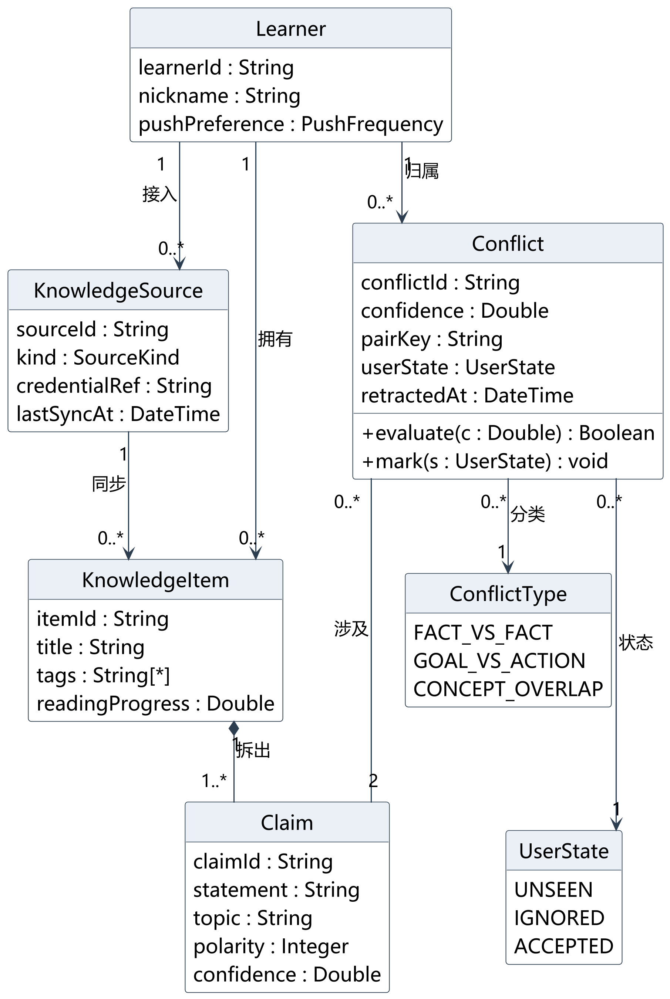

*图 A-1a　知识资产与冲突：Learner 拥有条目，条目拆出主张，冲突比对两条主张*

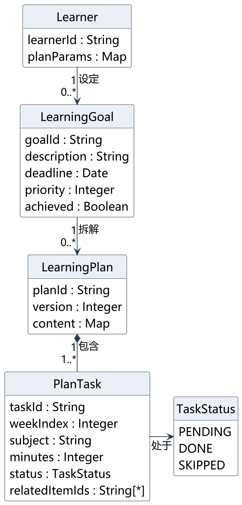

*图 A-1b　目标与计划：目标拆解为计划，计划含周任务，任务可引用知识条目。version 为乐观锁版本号，重规划写回同一行；旧计划是否留档属待确认项*

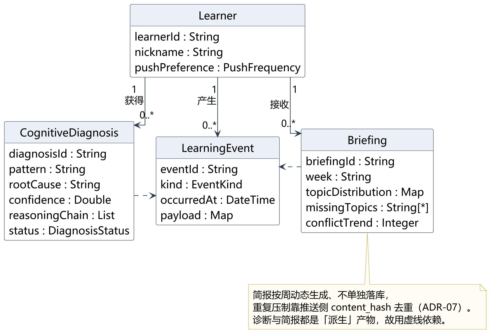

*图 A-1c　行为、诊断、简报：诊断与简报都是由行为数据算出的产物，与行为事件为派生依赖*

#### 3.3.1 领域类规格表

| 类 | 职责（一句话） | 关键属性 | 不变量 / 规则 | 依据 |
|---|---|---|---|---|
| Learner | 一切读写的作用域主体 | learnerId、nickname、pushPreference | 任何能力只能作用于本人资源 | 角色权限；TABLE 8 |
| KnowledgeSource | 外部知识库的接入凭据与同步状态 | sourceId、kind、credentialRef、lastSyncAt | 凭证加密存储、不落日志 | UC-G-01；安全-2 |
| KnowledgeItem | 知识库基本单位，提供待比对内容 | itemId、title、content、tags、readingProgress | **只读**：冲突检测不得改写原文 | IN-01；OUT-01 |
| Claim | 条目里的一句可判定主张 | claimId、statement、topic、polarity、confidence | 必须归属唯一条目，随条目删除而消失 | IN-01；ADR-09 |
| Conflict | 冲突结论的持有者与规则守卫 | confidence、pairKey、userState、retractedAt | 见 3.3.2 | IN-01；BR-L2-01/02 |
| LearningGoal | 学习者设定的目标 | goalId、description、deadline、priority、achieved | 达成后不再产生新任务 | UC-L4-01 |
| LearningPlan | 目标的可执行拆解 | planId、version、content | version 为乐观锁；重规划写回同一行 | UC-L4-01；可靠-2 |
| PlanTask | 周维度的具体任务 | taskId、weekIndex、subject、minutes、status、relatedItemIds | 引用条目而不复制内容 | UC-L4-01 |
| LearningEvent | 阅读/收藏/问答等行为事实 | eventId、kind、occurredAt、payload | 只追加，不改写 | UC-L4-02；UC-L5-01 |
| CognitiveDiagnosis | 偏误诊断结论 | pattern、rootCause、confidence、reasoningChain、status | 必须带推理链；低置信须标"待验证" | UC-L5-01/02 |
| Briefing | 周度认知简报 | week、topicDistribution、missingTopics、conflictTrend | 按周动态生成，不单独落库 | UC-L3-01 |

#### 3.3.2 Conflict 的四条不变量

这四条是整份文档里最需要盯住的东西——它们是"规则由谁保护"的判据：

| 编号 | 不变量 | 违反后果 | 保护者（设计层） |
|---|---|---|---|
| INV-1 | 冲突双方主张必须归属同一 Learner | 出现跨用户冲突，直接越权 | 候选对生成的 user_id 过滤 + 归属校验 |
| INV-2 | confidence ∈ [0,1]，< 0.5 不入库 | 误报污染列表（AT-L2-02 失败） | `evaluate()` + `l2_min_confidence` |
| INV-3 | pairKey 有序拼接，同一对主张只存一行 | 重复推送同一冲突（AT-L2-01 干扰） | `upsert` + `pair_key` 唯一口径 |
| INV-4 | retractedAt 非空即撤回，所有读路径排除 | 已推翻的结论继续误导用户 | 仓储读路径默认过滤 |

> **INV-3 的细节**：pairKey 由两条主张 id 排序后拼接，与判定顺序无关。同一对主张无论先判 a 还是先判 b，都映射到同一个键——这是"重复扫描不产生重复冲突"的全部机制，不靠应用层记状态。

### 3.4 分析类图（BCE）

BCE 的分工规则只有三条，但每一条都对应一次真实的翻车：

| 角色 | 该做 | 不该做 | 判据 |
|---|---|---|---|
| 边界 Boundary | 协议转换、输入校验、把结果渲染成用户能看的东西 | 业务判断、直接改实体 | 换个前端（Web→App）不该改它 |
| 控制 Control | 编排顺序、事务边界、异常转换 | 持有规则、持有状态 | 换条流程不该改实体，改条规则不该改它 |
| 实体 Entity | 持有状态、保护不变量 | 调用外部服务、发通知 | 规则能否被单测钉死 |

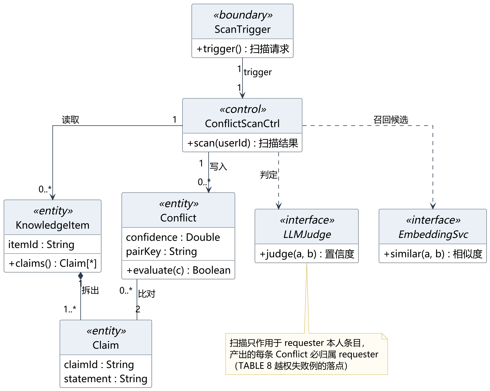

*图 A-2a　扫描：边界只发起，控制只编排，实体持有结论*

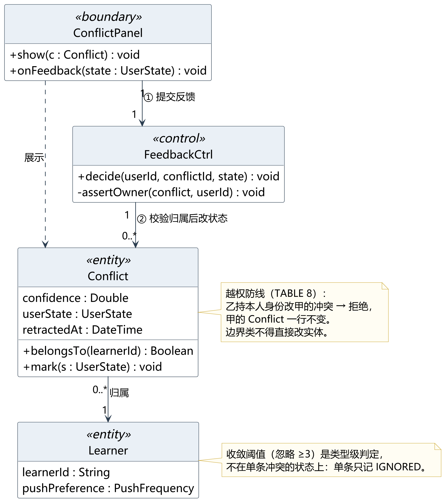

*图 A-2b　反馈：用户看到的那张卡片，与"改状态的那只手"是两件事*

**为什么把扫描和反馈分开画**：它们共享 Conflict 与 Learner，但协作路径不同——扫描是"系统主动、无人参与"，反馈是"用户主动、必须校验归属"。画在一张图上会让人误以为二者是同一条流程。

#### 3.4.1 其余用例的 BCE 对照

同一套分工模式套到其余能力上（不逐张画图，列职责分配即可复核）：

| 用例 | 边界类 | 控制类 | 实体类 |
|---|---|---|---|
| UC-L1-01 模糊挖掘 | 搜索输入框、候选卡片 | L1Orchestrator（多轮收敛） | KnowledgeItem、LearningEvent |
| UC-L3-01/02 简报与追问 | 简报卡片、追问气泡 | L3Orchestrator | KnowledgeItem、Conflict、LearningEvent |
| UC-L4-01/02 计划与偏离 | 目标表单、计划表、干预对话 | L4Orchestrator（重规划） | LearningGoal、LearningPlan、PlanTask、LearningEvent |
| UC-L5-01/02 诊断 | 诊断报告页 | L5Orchestrator（归因） | LearningEvent、CognitiveDiagnosis |

### 3.5 动态分析：冲突生命周期

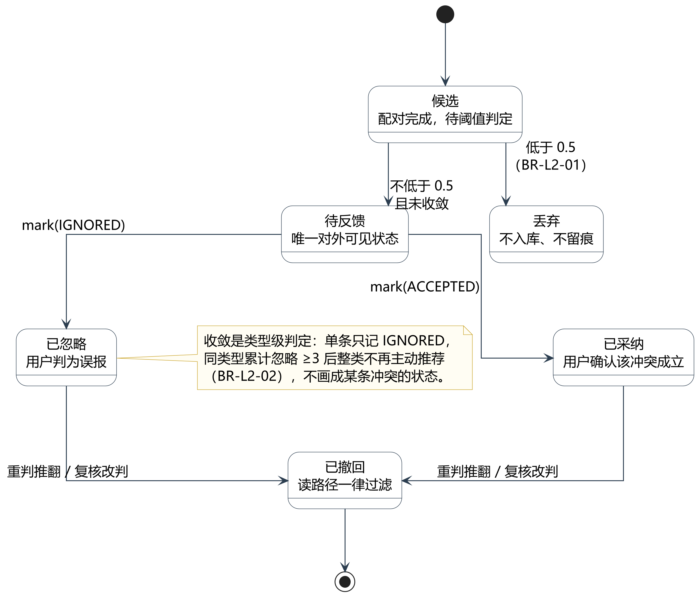

*图 A-3　六个状态，两条终态；「待反馈」是唯一对外可见状态*

| 状态 | 进入条件 | 出口事件 | 对外可见 |
|---|---|---|---|
| 候选 | 主张配对完成、等待阈值判定 | 判定结果 | 否 |
| 丢弃 | confidence < 0.5 | —（终态） | 否，且不留痕 |
| 待反馈 | confidence ≥ 0.5 且该类型未收敛 | 用户忽略/采纳、重判推翻 | **是** |
| 已采纳 | mark(ACCEPTED) | 重判推翻 | 是 |
| 已忽略 | mark(IGNORED) | 重判推翻 | 是 |
| 已撤回 | 终判改口 | —（终态） | 否（读路径过滤） |

> **一个刻意的取舍**：收敛（忽略 ≥3 次不再推荐）**没有**画成某个状态。"忽略三次"是**类型级**判定，不是某条冲突的状态迁移——把它画成状态会在汇报时被问住："到底哪一条进入了收敛态？"答案是：没有哪一条，是这一类整体被降权。

### 3.6 分析阶段的遗留问题

| 编号 | 问题 | 影响 | 处置 |
|---|---|---|---|
| AQ-01 | 置信度阈值 0.5 为配置初值，未按真实模型分布标定 | 阈值偏低则误报多，偏高则漏报（第4课 4ce1605 的教训） | 待用真实判定样本标定后冻结 |
| AQ-02 | "忽略 ≥3 次"的计数口径：按类型 / 按用户 / 是否限时间窗 | 影响收敛时机，进而影响用户信任 | 需求侧确认口径后写进 BR-L2-02 |
| AQ-03 | 简报不落库，历史简报无法复盘 | 用户问"上周说了什么"答不上来 | 列为后续需求（可能需要 Briefing 持久化） |
| AQ-04 | 诊断被"采纳"之后与计划的关系只有一句话（拆为任务） | 采纳→任务生成的链路未细化 | 设计阶段以 L4 重规划承接，先记录 |

---

## 4. 设计模型

### 4.1 设计目标

| 目标 | 具体含义 | 验证方式 |
|---|---|---|
| 规则可测 | 阈值、去重、收敛能脱离 HTTP 与数据库单测 | 不启服务，直接 new 实体断言 |
| 模型可换 | 换 LLM 供应商、换嵌入模型不改领域代码 | 只改装配处 |
| 越权不可能 | 不是"记得加 where"，而是结构上访问不到 | 跨用户访问抛异常 |
| 结论可追溯 | 判过什么、为什么没入库，都能查 | 判定日志自包含 |
| 依赖朝内 | 领域层不 import 框架 | 依赖检查 / 代码评审 |

### 4.2 分层与包结构

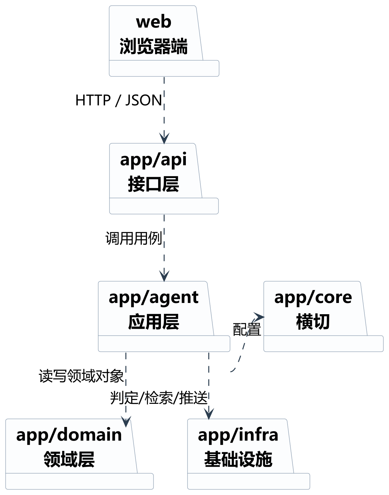

*图 D-2　只允许由外向内：web → api → agent → {domain, infra}，core 被各层依赖。反向依赖一律视为设计缺陷*

| 层 | 包 | 职责 | 允许依赖 | 禁止依赖 |
|---|---|---|---|---|
| 表现 | `web/` | 页面、卡片渲染、前端状态 | api（HTTP） | 直连数据库 |
| 接口 | `app/api/` | 路由、鉴权、DTO 转换 | agent、core | 直连领域写入 |
| 应用 | `app/agent/` | 用例编排、事务边界、降级 | domain、infra、core | 被 domain 反向依赖 |
| 领域 | `app/domain/` | 实体、不变量、仓储端口 | core（配置/工具） | FastAPI、Session、HTTP 客户端 |
| 基础设施 | `app/llm`、`app/retrieval`、`app/books`、`app/weread`、`app/push` | 模型、检索、接入、触达的实现 | domain 端口 | 反向依赖应用层 |
| 横切 | `app/core/` | 配置、安全、日志、链路 | 无 | 依赖任何业务层 |

> **依赖倒置的落点**：domain 只声明 `ConflictRepository`、`LLMJudgePort` 这类接口；实现由 agent 在装配时注入。这样"领域不依赖模型供应商"不是口号，而是编译期就成立的事实。

### 4.3 设计类图

设计类图拆成三张，每张只回答一个问题：**谁转发**（D-1a）、**规则守在哪**（D-1b）、**换模型为什么不用改领域**（D-1c）。一张图塞十个类没人看得清，这是分图唯一的理由；三张图共用同一套类名，不重复定义。

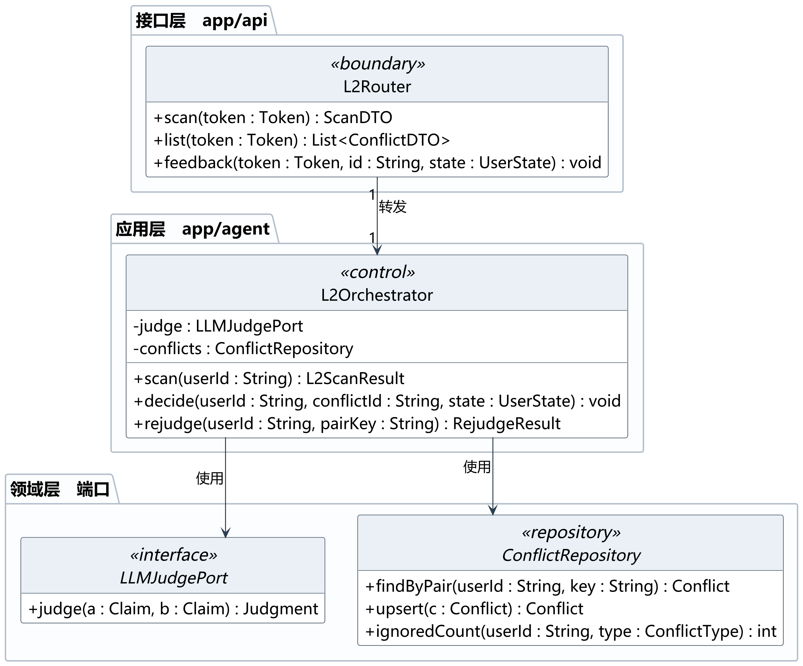

*图 D-1a　Router 只做协议转换与转发（不判业务），Orchestrator 只持有两个端口引用、只负责排序与事务，依赖一律朝内*

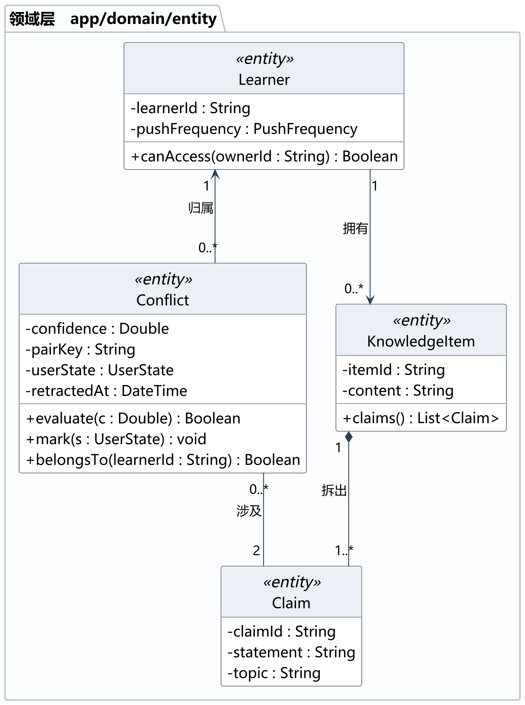

*图 D-1b　规则长在实体上：阈值、收敛、状态迁移、归属、撤回五处都在 Conflict 内部，编排器碰不到它们*

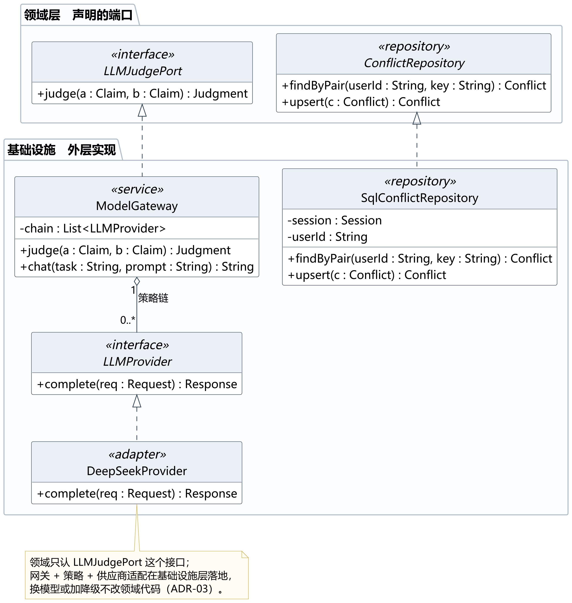

*图 D-1c　领域只声明 LLMJudgePort；网关 + 策略链 + 供应商适配都在基础设施层，换模型不动领域代码*

#### 4.3.1 设计类规格表

| 类 | 层 | 职责 | 关键操作 | 依赖 | 依据 |
|---|---|---|---|---|---|
| L2Router | 接口 | 路由与 DTO 转换 | scan / list / feedback / rejudge / attribute | L2Orchestrator | UC-L2-01/03 |
| L2Orchestrator | 应用 | 一次扫描的编排与事务边界 | scan / decide / rejudge | 端口 + 仓储 | IN-01 |
| Conflict | 领域 | 持有结论与不变量 | evaluate / mark / isConverged / belongsTo / retract | Learner | BR-L2-01/02 |
| Claim | 领域 | 可判定最小单位 | —（由条目拆出） | KnowledgeItem | IN-01 |
| KnowledgeItem | 领域 | 内容持有者（只读） | claims() | — | OUT-01 |
| Learner | 领域 | 作用域主体 | canAccess(ownerId) | — | 角色权限 |
| ConflictRepository | 端口 | 冲突持久化契约 | findByPair / findById / upsert / retract / ignoredCount | Conflict | INV-3/4 |
| LLMJudgePort | 端口 | 语义判定契约 | judge(a, b) | Claim | IN-01 |
| ModelGateway | 基础设施 | 网关 + 策略 + 降级 | judge / chat | LLMProvider | 可换性 |
| SqlConflictRepository | 基础设施 | 仓储实现，绑定 userId | 同端口 | Session | TABLE 8 |
| DeepSeekProvider | 基础设施 | 供应商适配 | complete(req) | — | ADR-03 |

#### 4.3.2 接口契约（L2 对外）

与实现一致（`app/api/endpoints/l2.py`）：

| 方法 | 路径 | 用途 | 越权防护 |
|---|---|---|---|
| POST | `/api/v1/l2/scan` | 触发一次扫描 | userId 取自 JWT |
| GET | `/api/v1/l2/conflicts` | 列出本人冲突 | 仓储作用域过滤 |
| PATCH | `/api/v1/l2/conflicts/{id}/state` | 忽略 / 采纳 | 归属校验，不匹配即 404/403 |
| GET | `/api/v1/l2/judgments` | 判定日志（排查用） | 同上 |
| POST | `/api/v1/l2/judgments/{pair_key}/rejudge` | 显式翻案 | 同上 |
| POST | `/api/v1/l2/conflicts/{id}/attribute` | 冲突归因 | 同上 |

> 注意 `PATCH .../state` 而不是 `PUT .../conflict`：这个接口只允许改状态这一个字段。第4课 E04 的教训是"通用 setter 让规则裸奔"，接口粒度是同一件事的另一面。

### 4.4 核心功能规约

类图回答"有哪些类、谁依赖谁"，但它不回答"这个功能做到什么程度算做对了"。规约（specification）补的就是这一层：**同一套栏位，把四条核心功能写成可验收的条目**，每条都能追到 UC / IN / BR，改需求时先改规约、再改模型。

| 栏位 | 写什么 | 判据 |
|---|---|---|
| 标识 | FS-编号 + 对应用例号 | 能追到 UC-* |
| 参与者 | 发起的人或系统 | 只能是角色表里的角色 |
| 触发 | 什么事件让它开始 | 定时 / 用户动作 / 数据入库 |
| 前置条件 | 开始前必须为真 | 不满足就不该启动，而不是启动后报错 |
| 主流程 | 编号步骤，一步一个动作 | 每步都能落到某个类的某个操作（见 4.6.3） |
| 扩展流 | 偏离主流程的分支 | 每条都能指到 BR-* 或 OUT-* |
| 后置条件 | 结束后必须为真 | 能直接写成断言 |
| 业务规则 | 本功能保护的规则 | 能指到规则编号 |
| 验收 | 验收例编号 | 能指到 AT-* |

#### 4.4.1 FS-01 冲突扫描（UC-L2-01）

| 项 | 内容 |
|---|---|
| 标识 | FS-01 / UC-L2-01 |
| 参与者 | 学习者（间接触发）、周定时装置 |
| 触发 | 周定时到达，或新内容入库 |
| 前置条件 | 令牌校验通过、userId 可解析；本人条目中至少有 2 条可判定主张 |
| 主流程 | ① 路由层验签解出 userId；② 读取本人条目与主张；③ 生成候选主张对；④ 逐对调用语义判定取置信度；⑤ 按阈值判定并去重；⑥ 入库并要求提醒 |
| 扩展流 | E1 候选不足 2 条 → 返回空结果，不进入判定；E2 置信度低于阈值 → 不入库（BR-L2-01）；E3 同一 pairKey 已存在 → 幂等写，不新增行、不重复提醒（INV-3）；E4 该类型已收敛 → 跳过并计入 suppressed（BR-L2-02） |
| 后置条件 | 新增冲突必归属 requester；confidence ∈ [0,1]；判定日志自包含（含双方文本） |
| 业务规则 | BR-L2-01、BR-L2-02、INV-1 – INV-4、OUT-01 |
| 验收 | AT-L2-01、AT-L2-02、AT-L2-03、AT-L2-04 |

#### 4.4.2 FS-02 冲突反馈与改判（UC-L2-03）

| 项 | 内容 |
|---|---|
| 标识 | FS-02 / UC-L2-03 |
| 参与者 | 学习者 |
| 触发 | 用户在冲突卡片上点「忽略 / 采纳」，或发起复核改判 |
| 前置条件 | 令牌校验通过；目标冲突存在且归属本人 |
| 主流程 | ① 路由层取 userId 与冲突 id；② 编排器按（userId, id）取冲突；③ 校验归属；④ 实体迁移状态；⑤ 写回并累计忽略次数；⑥ 达阈值则该类型收敛 |
| 扩展流 | E1 冲突不存在 → 404；E2 存在但不归属本人 → 403，数据一行不变（TABLE 8）；E3 同类型忽略累计达 3 → 该类不再主动推荐（BR-L2-02）；E4 复核改判推翻原结论 → 原冲突撤回而非删除（INV-4） |
| 后置条件 | 只有被授权的冲突状态发生变化；撤回行保留且读路径过滤 |
| 业务规则 | 角色权限、BR-L2-02、INV-4 |
| 验收 | AT-L2-03、AT-L2-04 |

#### 4.4.3 FS-03 目标与学习计划（UC-L4-01）

| 项 | 内容 |
|---|---|
| 标识 | FS-03 / UC-L4-01 |
| 参与者 | 学习者 |
| 触发 | 用户设定 / 修改目标，或计划到期需要重排 |
| 前置条件 | 目标描述非空；期限晚于当前日期 |
| 主流程 | ① 记录目标（描述、期限、优先级）；② 按期限与优先级拆解为周计划；③ 计划拆为周任务并标注时长；④ 任务可引用知识条目；⑤ 写回计划（版本号 +1） |
| 扩展流 | E1 目标已达成 → 不再产生新任务；E2 实施中偏离计划 → 触发重规划，写回同一行并升版本（乐观锁）；E3 任务引用的条目已删除 → 任务保留、引用置空 |
| 后置条件 | 任一计划版本内的任务总时长不超过计划容量；任务只引用条目、不复制内容 |
| 业务规则 | 可靠-2（乐观锁）、OUT-01（不改写条目） |
| 验收 | 偏离检测用例（第 16 章追踪矩阵） |

#### 4.4.4 FS-04 认知诊断（UC-L5-01）

| 项 | 内容 |
|---|---|
| 标识 | FS-04 / UC-L5-01 |
| 参与者 | 学习者 |
| 触发 | 用户请求诊断，或周度例行诊断 |
| 前置条件 | 存在可统计的行为事件（阅读、收藏、问答） |
| 主流程 | ① 读取本人行为事件；② 汇总主题分布与缺失主题；③ 归因生成诊断结论；④ 生成推理链；⑤ 落库并标注置信度 |
| 扩展流 | E1 行为样本不足 → 不出结论，返回"数据不足"；E2 置信度不足 → 结论显式标注「待验证」；E3 结论被采纳 → 转成计划任务（经 FS-03 承接） |
| 后置条件 | 每条诊断必须携带 reasoningChain，否则不得对外展示 |
| 业务规则 | UC-L5-02（可复核性） |
| 验收 | 诊断报告可逐条追溯到行为事件 |

> **规约写到这里就够用了**：再往下写就是界面文案，那是原型的事；再往上写就是需求文档，第一篇已经有了。规约的用处只有一个——评审时拿它问"这条你怎么验"，答不上来说明这条还没想清楚。

### 4.5 关键交互与事务边界

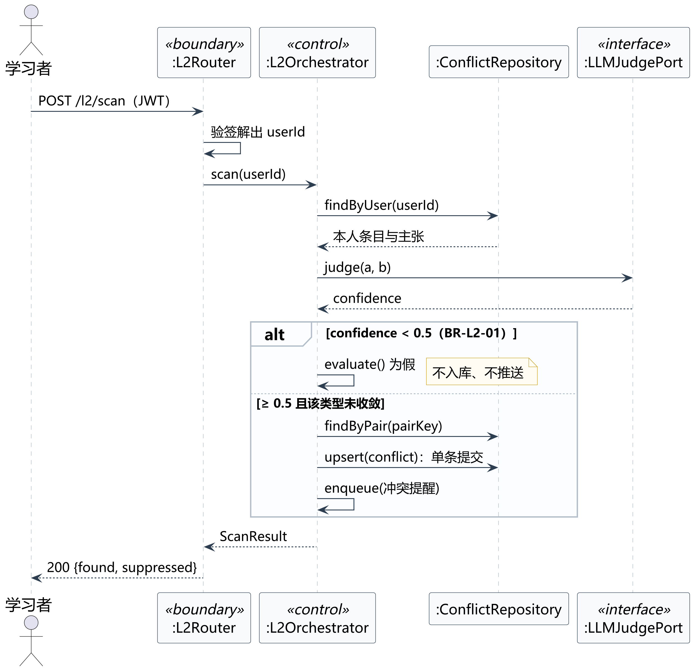

*图 D-3　userId 只从 token 取；判定在事务外，入库才开写*

| 操作 | 事务范围 | 为什么 |
|---|---|---|
| 验签取 userId | 无事务 | 纯计算 |
| 读条目与主张 | 只读事务 | 快速释放 |
| LLM 判定 | **无事务** | 一次往返 2–5 秒，不能占着写锁等 |
| 阈值过滤 + upsert | 单条写事务，立即提交 | 避免长事务；失败只影响这一对 |
| 推送入队 | 独立事务 | 推送失败不能回滚已入库的冲突 |

> **写锁不跨模型调用**是这份设计里最容易被忽略、代价最高的一条。若把判定包进写事务，一次 3 秒的模型调用会让整库写操作排队——单用户看不出问题，多用户直接雪崩。

### 4.6 选定功能的设计类详解：L2 冲突检测

#### 4.6.1 为什么选它

五条能力里，L2 是唯一同时具备三个特征的：链路最长（边界 → 应用 → 领域 → 端口 → 基础设施，五层全过一遍）、规则最密（阈值、去重、收敛、归属、撤回，五条规则各有归属）、有真实的失败例（TABLE 8 的越权把设计缺陷暴露在最难看的位置）。讲清 L2，其余四条只是它去掉某一段。

#### 4.6.2 设计类一览

| 类（层 · 类型） | 关键属性 | 关键操作 | 协作者 | 必须始终成立 | 依据 |
|---|---|---|---|---|---|
| L2Router\n接口 · «boundary» | — | scan(token) / list(token) / feedback(token,id,state) | L2Orchestrator | 不读请求体里的 user_id | TABLE 8 |
| L2Orchestrator\n应用 · «control» | judge / conflicts | scan(userId) / decide(…) / rejudge(…) | 端口 + 实体 | 不持有业务规则；判定在事务外 | ADR-01、ADR-04 |
| Conflict\n领域 · «entity» | confidence / pairKey / userState / retractedAt | evaluate(c) / mark(s) / isConverged(n) / belongsTo(id) / retract(at) | Learner、Claim | INV-1 – INV-4 时刻成立 | BR-L2-01/02 |
| Claim\n领域 · «entity» | claimId / statement / topic / polarity | —（由条目拆出） | KnowledgeItem | 归属唯一条目，随条目删除 | IN-01 |
| KnowledgeItem\n领域 · «entity» | itemId / content | claims() | Claim | 只读，任何能力不得改写 | OUT-01 |
| ConflictRepository\n领域 · 端口 | userId（构造时绑定） | findByPair / findById / upsert / retract / ignoredCount | Conflict | 跨用户行直接抛 PermissionError | ADR-02 |
| LLMJudgePort\n领域 · 端口 | — | judge(a, b) | Claim | 不感知供应商、重试与降级 | ADR-03 |
| ModelGateway\n基础设施 · «service» | chain | judge(a, b) / chat(task, prompt) | LLMProvider | 失败按链降级，不改业务分支 | ADR-03 |
| SqlConflictRepository\n基础设施 · «repository» | session / userId | 同端口 | Session | 读路径默认过滤 retractedAt | INV-4 |

> **谁也别越界**：Router 不认识实体，Orchestrator 不认识 SQL，实体不认识 HTTP，Gateway 不认识冲突。四个"不认识"就是这张表真正的信息量——评审时逐个问"它凭什么认识"，答不上来的依赖就该删。

#### 4.6.3 主流程逐步落点

FS-01 的六个主步骤，落到具体的类与操作上：

| 步骤 | 动作 | 落在哪 | 事务 |
|---|---|---|---|
| ① | 收请求、验签、取 userId | `L2Router.scan` | 无 |
| ② | 读本人条目与主张 | `L2Orchestrator.scan` → `ConflictRepository.findByUser` | 只读 |
| ③ | 生成候选主张对 | `L2Orchestrator` 内部（不碰数据库） | 无 |
| ④ | 语义判定取置信度 | `LLMJudgePort.judge`（实现：`ModelGateway` → `DeepSeekProvider`） | **无事务** |
| ⑤ | 阈值判定 + pairKey 去重 | `Conflict.evaluate` + `ConflictRepository.findByPair` | 无 |
| ⑥ | 入库 + 要求提醒 | `ConflictRepository.upsert` → `PushService.enqueue` | 单条写事务 / 独立事务 |

#### 4.6.4 关键操作契约

契约写的是"调用前后必须为真"，不写实现步骤。这是规约与代码之间最短的一条桥：

| 编号 | 操作 | 前置条件 | 后置条件 | 失败语义 | 依据 |
|---|---|---|---|---|---|
| OC-01 | `L2Orchestrator.scan(userId)` | userId 非空且来自令牌；本人条目存在 | 返回 ScanResult；入库行全部归属 userId | 单对失败不回滚已成功对，记入失败计数 | IN-01 |
| OC-02 | `Conflict.evaluate(c)` | c 为 [0,1] 的实数 | 返回 c ≥ 阈值的布尔值；不修改对象状态 | 越界输入视为编码错误，直接抛 | BR-L2-01 |
| OC-03 | `ConflictRepository.upsert(conflict)` | conflict 的 pairKey 已算好；会话已绑定 userId | 同一 pairKey 至多一行；返回库中行 | 跨用户写入抛 PermissionError | INV-3、TABLE 8 |
| OC-04 | `L2Orchestrator.decide(userId, id, state)` | 冲突存在且归属 userId | userState 变为目标状态；忽略计数 +1 | 不存在 → NotFound；不归属 → PermissionError | 角色权限 |
| OC-05 | `L2Orchestrator.rejudge(userId, pairKey)` | 该 pairKey 有判定日志 | 原冲突置撤回、旧结论保留可查 | 无日志 → 拒绝（不允许无据翻案） | INV-4、ADR-06 |

#### 4.6.5 反馈与改判链路

扫描是"系统主动、无人参与"，反馈是"用户主动、必须校验归属"。两条链路共用同一套类，但事务与防线完全不同，所以分开画：

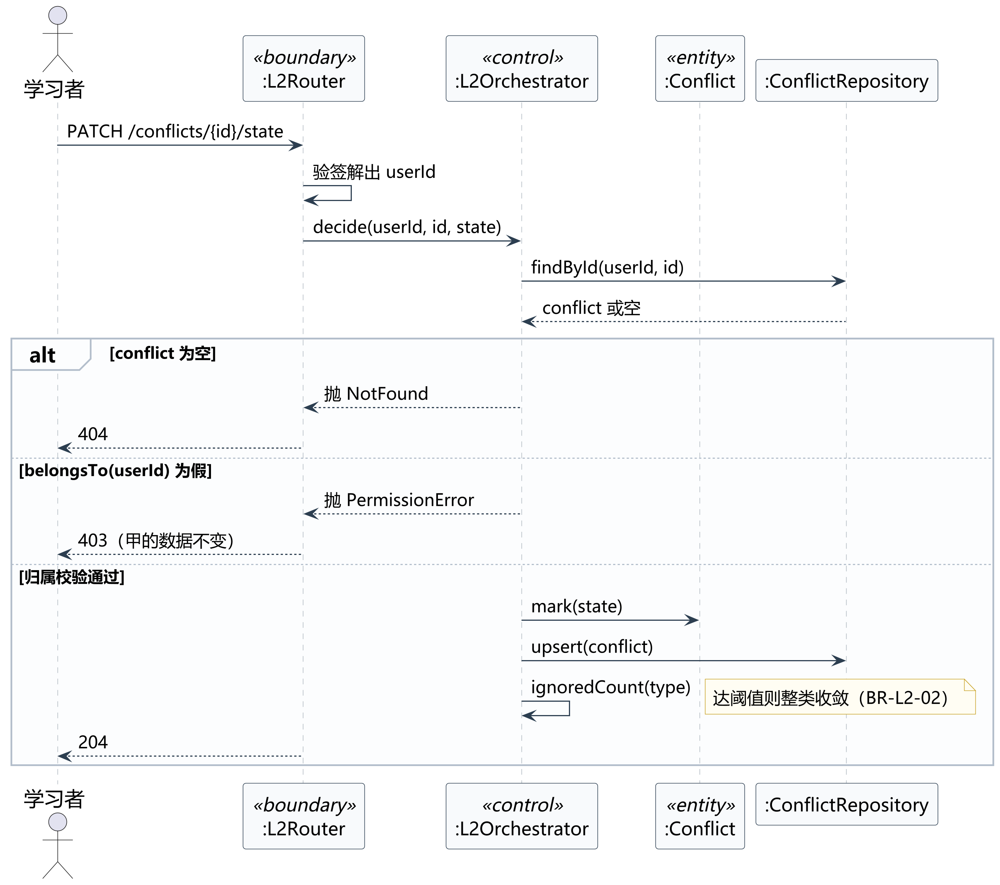

*图 D-4　先查归属再改状态：查不到 → 404，查到但不归属 → 403。两道防线叠加，任一层单独失守都不至于越权*

**为什么不是"查到就改"**：如果只靠仓储的 `userId` 作用域，一旦有代码绕过仓储（比如直接拼 SQL、或从别处拿到 ORM 会话），防线就没了；如果只靠实体的 `belongsTo`，写漏一处判断就破。两个都在，才叫"结构上不可能"——这也是 3.4 里"边界类不得直接改实体"那条规则的实证。

### 4.7 分析到设计的映射

| 分析元素 | 设计元素 | 变化类型 | 理由 |
|---|---|---|---|
| Learner | `User`（`users` 表） | 更名 + 扩展 | 分析关心角色权限，设计要落登录、令牌版本、软删 |
| Conflict | `Conflict` + 规则方法 | 落地 | 规则从编排器收回实体（当前部分仍在 `_apply_verdict`，见 4.9） |
| ConflictScanCtrl | `L2Orchestrator` | 具体化 | 命名落地，注入端口与仓储 |
| FeedbackCtrl | `L2Orchestrator.decide` | 具体化 | 反馈与扫描共用编排器，但走不同入口 |
| LLMJudge | `LLMJudgePort` ← `ModelGateway` ← `LLMProvider` | 细化 | 加网关、策略、降级，实现可换 |
| （无） | `ConflictRepository` | **新增** | 持久化分离 + 结构性越权防护 |
| （无） | `L2JudgmentLog` | **新增** | 非矛盾判定本不留痕，排查"为什么没抓到"只能重烧钱 |
| （无） | `deps.get_current_user` | **新增** | 令牌解析，userId 的唯一来源 |
| PushJob / PushLog | 通知子域实体 | 移出领域图 | 属调度与去重机制，不是业务概念 |
| Briefing | 运行时视图 + `PushJob` 载荷 | 降级为计算产物 | 当前不落库，幂等靠 `content_hash` |

### 4.8 设计决策记录（ADR 摘要）

| 编号 | 决策 | 替代方案 | 为什么这么选 | 代价 |
|---|---|---|---|---|
| ADR-01 | 规则放实体，编排器只排序与事务 | 规则写在 Service（贫血模型） | 规则可单测、无法被绕过 | 实体变"厚"，需要领域知识 |
| ADR-02 | 仓储构造即绑定 userId | 每个查询自己加 where | 越权从"自觉"变"结构不可能" | 跨用户统计要另开通道 |
| ADR-03 | 模型能力走端口 + 网关 + 策略链 | 直接调 SDK | 换供应商、加降级不改业务 | 多一层间接，排查要跟链路 |
| ADR-04 | 判定在事务外，逐条提交 | 一次大事务 | 不占写锁、失败影响面小 | 可能部分成功，需幂等 |
| ADR-05 | 撤回而非物理删除 | DELETE | 可追溯"为什么这条消失了" | 所有读路径都要过滤 |
| ADR-06 | 判定日志自包含（存标题与文本） | 只存 claim_id 外键 | 主张会被重扫替换，外键会静默丢文本 | 冗余存储 |
| ADR-07 | 简报不落库，按周计算 | 落一张 briefings 表 | 少一张表、少一次迁移 | 历史简报无法复盘（AQ-03） |

### 4.9 与当前实现的一致性核对

设计文档最容易犯的错，是写一份"理想架构"然后当作现状。这张表把差距摊开：

| 设计元素 | 现状 | 差距 | 处置 |
|---|---|---|---|
| `Conflict.evaluate()` 持有阈值判断 | 阈值判断在 `L2Orchestrator._apply_verdict` | 规则仍在编排器 | 技术债；迁移时先补实体单测 |
| `Conflict.isConverged()` | 收敛在 `_suppressed_types()` 计算 | 同上 | 同上 |
| `ConflictRepository` 绑定 userId | `BaseRepository._guard()` 已实现 | 一致 | — |
| pairKey 去重 | `make_pair_key` + `upsert_from_rejudge` | 一致 | — |
| 撤回软删 + 读路径过滤 | `retracted_at` + 读路径过滤 | 一致 | — |
| 判定日志 | `l2_judgment_logs` 已落库、自包含 | 一致 | — |
| 依赖倒置（领域不碰框架） | 实体为 SQLAlchemy 模型 | 领域模型继承 ORM 基类 | 折中：P0 用 ORM 实体，端口已隔离读写 |
| 简报持久化 | 未落库 | 与设计一致（ADR-07） | 记录为 AQ-03 |

> 这张表的作用不是自我批评，是**让评审知道哪一条能今天就改、哪一条要排期**。把技术债藏起来，等于把风险留到上线后。

## 5. 追踪与验收

### 5.1 追踪矩阵

| 设计元素 | 分析元素 | 用例 | 规则 / 依据 |
|---|---|---|---|
| `L2Router.scan` | ScanTrigger | UC-L2-01/02 | IN-01 |
| `L2Orchestrator.scan` | ConflictScanCtrl | UC-L2-01 | IN-01 |
| `Conflict.evaluate` | Conflict（实体规则） | UC-L2-01 | BR-L2-01 |
| `Conflict.isConverged` | Conflict（实体规则） | UC-L2-03 | BR-L2-02 |
| `Conflict.belongsTo` | Conflict / Learner | UC-L2-03 | 角色权限；TABLE 8 |
| `L2Router.feedback` → `decide` | FeedbackCtrl | UC-L2-03 | 角色权限 |
| `ConflictRepository.findByPair/upsert` | Conflict | UC-L2-01 | INV-3 |
| 读路径 `retractedAt IS NULL` | Conflict | UC-L2-01 | INV-4 |
| `LLMJudgePort.judge` | LLMJudge | UC-L2-01 | IN-01 |
| `L2JudgmentLog` | （设计新增） | UC-L2-01 | 可追溯性 |

### 5.2 验收走查

| 验收例 | 条件 | 预期 | 模型如何解释 |
|---|---|---|---|
| AT-L2-01 | 置信度 = 0.50 | 入库、可查询 | `evaluate(0.50)` → true（≥ 0.5）；upsert 落一行 |
| AT-L2-02 | 置信度 = 0.49 | 不入库、不出现 | `evaluate(0.49)` → false；无写事务 |
| AT-L2-03 | 同类型第 3 次忽略 | 不再主动推荐 | `ignoredCount ≥ 3` → 类型收敛，跳过该类型候选 |
| AT-L2-04（TABLE 8） | 乙改甲的冲突状态 | 拒绝（404/403），甲数据不变 | 仓储绑定乙的 userId + `belongsTo` 校验，双重拦截 |

**AT-L2-04 为什么需要两重**：只靠 `belongsTo` 是应用层判断，写漏一处就破；只靠仓储作用域是数据层过滤，一旦有代码绕过仓储就破。两者叠加，任一层单独失守都不至于越权——这就是 3.4 里"边界不得直接改实体"的实证。

### 5.3 模型自检清单

| 检查项 | 结论 | 说明 |
|---|---|---|
| 每个类都能指到 UC/IN/BR | 通过 | 见 3.2 与 5.1 |
| 每个规则都有唯一保护者 | 部分 | 阈值/收敛当前仍在编排器（4.9 已列） |
| 每条关联都有多重性与语义 | 通过 | 见 A-1a/b/c |
| 分析模型不含技术词汇 | 通过 | 无 Repository/HTTP/表名（设计层才出现） |
| 设计模型含可见性与类型 | 通过 | D-1a / D-1b |
| 关键路径有交互图 | 通过 | D-3 |
| 失败例可被模型解释 | 通过 | AT-L2-02 / AT-L2-04 |

---

## 6. 风险与后续

| 风险 | 触发条件 | 影响 | 缓解 |
|---|---|---|---|
| 阈值未标定（AQ-01） | 真实判定分布与初值偏离 | 误报或漏报，直接伤信任 | 收集 200 对人工标注样本后标定并冻结 |
| 规则仍在编排器（4.9） | 新增一条规则 | 规则分散，重复实现 | 排期把 evaluate/isConverged 收回实体并补单测 |
| 长事务误用 | 有人把判定包进写事务 | 并发雪崩 | 代码评审红线 + 顺序图作为验收依据 |
| 无历史简报（AQ-03） | 用户回溯上周简报 | 无法回答 | 后续加 Briefing 持久化 |
| 领域模型继承 ORM 基类 | 引入第二个数据源 | 领域层被迫改 | 端口已隔离；如换存储再抽纯领域模型 |

**下一步（按优先级）**

1. 把 `evaluate` / `isConverged` 从 `L2Orchestrator` 迁回 `Conflict`，并补实体单测（可独立验证，不依赖服务）。
2. 用真实样本标定 `l2_min_confidence`，把结果写进 BR-L2-01 并冻结。
3. 确认 AQ-02 的收敛计数口径，落进需求文档。
4. 评估是否补 Briefing 持久化。

---

## 附录 A　图清单与重渲染

全部图由 PlantUML 从 `.puml` 生成，统一风格写在 `diagrams/_style.puml`（正交走线、300 dpi、中文字体）；改一处风格全图生效，不要在单张图里覆盖。

| 文件 | 内容 | 用于 |
|---|---|---|
| `diagrams/a1a_domain_knowledge.puml` | 领域类图（知识资产与冲突） | 3.3 |
| `diagrams/a1b_domain_plan.puml` | 领域类图（目标与计划） | 3.3 |
| `diagrams/a1c_domain_diagnosis.puml` | 领域类图（行为、诊断、简报） | 3.3 |
| `diagrams/a2a_analysis_scan.puml` | 分析类图（扫描） | 3.4 |
| `diagrams/a2b_analysis_feedback.puml` | 分析类图（反馈与越权） | 3.4 |
| `diagrams/a3_state_conflict.puml` | 状态图（冲突生命周期） | 3.5 |
| `diagrams/d2_package.puml` | 包图（分层依赖） | 4.2 |
| `diagrams/d1a_design_l2.puml` | 设计类图（接口 → 应用 → 端口） | 4.3 |
| `diagrams/d1b_design_entity.puml` | 设计类图（领域实体） | 4.3 |
| `diagrams/d1c_design_ports.puml` | 设计类图（端口与实现） | 4.3 |
| `diagrams/d3_seq_scan.puml` | 顺序图（L2 扫描） | 4.5 |
| `diagrams/d4_seq_feedback.puml` | 顺序图（L2 反馈与越权） | 4.6.5 |

重渲染（需要 Java）：

```bash
java -jar tools/plantuml.jar -charset UTF-8 -tpng diagrams/a1a_domain_knowledge.puml   # 依次渲染其余 .puml
java -jar tools/plantuml.jar -charset UTF-8 -tsvg diagrams/a1a_domain_knowledge.puml
```

`.puml` 里不要写 `title`：图号与图名统一由文档图注给出，同一张 PNG 才能同时供单册与合订本使用。渲染后若图片高度超过 16.5 cm 会被缩到版面内，字会跟着变小——所以宁可按"一图一问题"拆图，也不要把十来个大类塞进一张。

## 附录 B　编号索引

| 编号 | 含义 | 出现位置 |
|---|---|---|
| IN-01 | L2 冲突检测范围（提取主张→配对→判定→带置信度结论） | 3.2、3.4、4.3 |
| OUT-01 | 非范围：不自动修改/删除用户知识条目 | 3.2、3.3.1、4.3 |
| BR-L2-01 | 置信度 < 0.5 丢弃，≥ 0.5 保留 | 3.3.2、4.3.1、4.6.4、5.2 |
| BR-L2-02 | 同类型忽略 ≥ 3 次后收敛 | 3.5、5.2 |
| AT-L2-01 – 04 | 验收例（阈值边界、收敛、越权） | 5.2 |
| TABLE 8 | 越权失败例（乙改甲的冲突） | 3.4、4.3、4.6、5.2 |
| INV-1 – 4 | 冲突不变量 | 3.3.2、5.1 |
| AQ-01 – 04 | 分析阶段遗留问题 | 3.6、6 |
| FS-01 – 04 | 核心功能规约（扫描 / 反馈 / 计划 / 诊断） | 4.4 |
| OC-01 – 05 | 关键操作契约（前置 / 后置 / 失败语义） | 4.6.4 |
| ADR-01 – 07 | 设计决策 | 4.8 |
